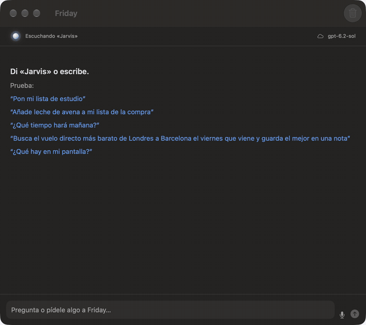
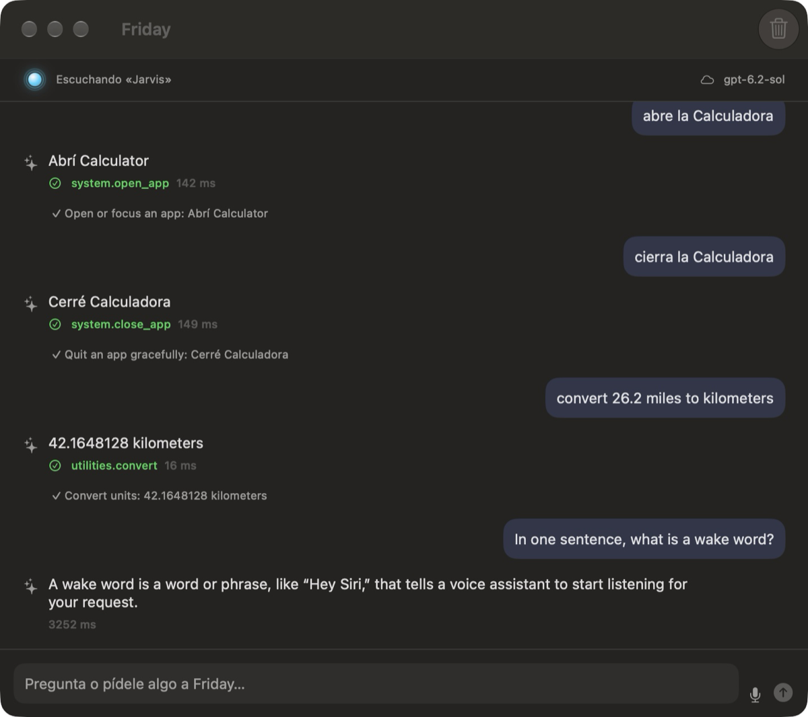
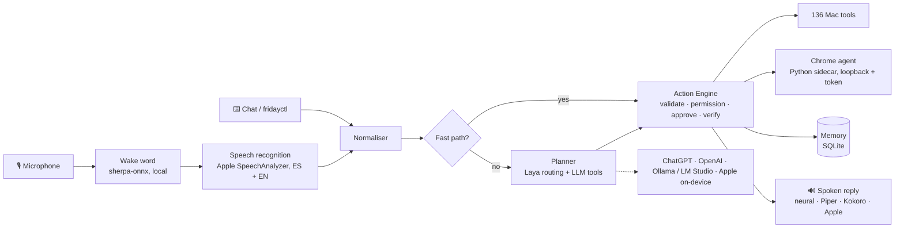

<p align="center">
  
</p>

<h1 align="center">Friday</h1>

<p align="center">
  <b>A bilingual (Spanish / English) voice assistant for macOS that actually does things — say “Jarvis”, ask, and
  Friday controls your Mac, its apps and Chrome, then answers out loud.</b>
</p>

<p align="center">
  <a href="https://github.com/Ale-Newport/Friday/actions/workflows/ci.yml"></a>
  <a href="https://github.com/Ale-Newport/Friday/actions/workflows/codeql.yml"></a>
  <a href="https://github.com/Ale-Newport/Friday/releases/latest"></a>
  <a href="LICENSE"></a>
  
  
  
</p>

<p align="center">
  <a href="https://ale-newport.github.io/Friday/">Website</a> ·
  <a href="#download">Download</a> ·
  <a href="#build-from-source">Build from source</a> ·
  <a href="#what-it-can-do">Features</a> ·
  <a href="ARCHITECTURE.md">Architecture</a> ·
  <a href="docs/CAPABILITY_MATRIX.md">What is verified</a> ·
  <a href="CONTRIBUTING.md">Contributing</a>
</p>

---

The GIF above is a real recording of Friday's chat window: each line was sent to the running app and every answer
came from it. The same commands work by voice.

```
"Jarvis."  →  "¿Sí?"  →  "Abre Chrome, busca el vuelo directo más barato de Londres a Barcelona el viernes
                           y guarda la mejor opción en una nota."
```

## Why Friday?

* **It acts, not just chats.** 136 typed, validated tools for Music, Reminders, Notes, Calendar, Contacts, Mail,
  Messages, Clock, files, weather, maths and system settings — each one permission-checked and **verified** after it
  runs, so Friday says what really happened.
* **Private by default.** The wake word, speech recognition and the common commands run **on your Mac**. Nothing
  leaves it unless you connect a cloud model or use an online voice.
* **Truly bilingual.** Speak Spanish, English or both in one sentence; Friday answers in the language you used.
* **Safe with your stuff.** Anything that sends, deletes, buys, uploads or publishes asks first.
* **Bring your own brain.** Your ChatGPT account (official *Sign in with ChatGPT*), an OpenAI key, a local model
  through Ollama or LM Studio — or no model at all for the built-in commands.

## What it can do

| | |
|---|---|
| 🎙️ **Voice** | Local “Jarvis” wake word (sherpa-onnx, no key, no network) · on-device recognition (Apple `SpeechAnalyzer`) with your app, playlist and contact names · follow-ups without the wake word · barge-in · “para” / “stop” ends everything silently |
| 🗣️ **Spoken replies** | Natural neural voices that start talking while the answer is still being written; offline Piper (Spanish), Kokoro and Apple voices as fallbacks |
| 🧠 **Understanding** | Deterministic fast path for everyday commands (milliseconds, no model), Laya intent routing, and an LLM planner with tool discovery and clarifying questions |
| 🖥️ **Your Mac** | Apps, windows, Accessibility-based computer control, “what's on my screen?”, files, system controls |
| 🌐 **The web** | An autonomous Chrome agent (DevTools Protocol) that browses, compares, fills forms and downloads — with approval prompts |
| 🗂️ **Memory** | Preferences, facts and routines in a local SQLite store (“remember that…”, “every morning…”) |
| 🎯 **Train “Jarvis”** | A short lesson that learns how *you* say the wake word and checks it over noise and music |
| ⌨️ **Scriptable** | `fridayctl` sends any command, plays a recording into the voice pipeline, or synthesises speech for tests |

See the **[capability matrix](docs/CAPABILITY_MATRIX.md)** for what is verified live, what is unit-tested and what
needs a model, and **[known limitations](docs/KNOWN_LIMITATIONS.md)** for the honest list of what does not work yet.

<p align="center">
  
</p>

## Download

**[Download the latest Friday for Apple Silicon](https://github.com/Ale-Newport/Friday/releases/latest)** (macOS 26+,
M1 or newer): unzip, drag **Friday.app** to Applications and open it. The app is ad-hoc signed but **not notarized**,
so macOS asks you to confirm it once in **System Settings ▸ Privacy & Security ▸ Open Anyway** —
**[docs/INSTALL.md](docs/INSTALL.md)** walks through it, including how to verify the download's checksum and build
provenance.

## Build from source

**Requirements:** macOS 26 or newer on Apple Silicon · Xcode 26.6 or newer (developed on Xcode 27; CI builds with 26.6) ·
[Homebrew](https://brew.sh). Google Chrome is optional (browser agent).

One command clones, fetches the pinned and checksum-verified speech models, sets up the Python sidecar, builds and
launches Friday:

```bash
brew install xcodegen uv && git clone https://github.com/Ale-Newport/Friday.git && cd Friday && make bootstrap run
```

Then allow the **Microphone**, say **“Jarvis”** and ask something — *“what time is it?”*, *“abre Notas”*,
*“what's 18% of 2,450?”*. To use a model for open questions and multi-step tasks, open
**Settings ▸ Intelligence ▸ Continue with ChatGPT**, or just run [Ollama](https://ollama.com) — Friday finds it.

The first `make bootstrap` downloads about 1 GB (≈ 150 MB of speech library and models, the rest the sidecar's Python
packages); the browser agent's Laya model (≈ 810 MB) is fetched on first use. Full walkthrough: **[docs/SETUP.md](docs/SETUP.md)** ·
permissions explained: **[docs/PERMISSIONS.md](docs/PERMISSIONS.md)**.

### Try it without talking

```bash
CTL=build/DerivedData/Build/Products/Debug/Friday.app/Contents/Helpers/fridayctl
$CTL "what's 18% of 2,450?"                               # → 441
$CTL "convierte 3 tazas en mililitros"                     # → 709,76 mililitros
$CTL --say "pasa 2 hectáreas a metros cuadrados" --speak  # runs the voice pipeline and speaks the answer
$CTL --synthesize "Jarvis, what time is it?" --language en --output /tmp/a.wav
$CTL --voice /tmp/a.wav                                    # a full voice turn from a file: wake word, transcript, reply
$CTL --tools | head                                        # the typed tools Friday can call
```

## How it works



Friday is a SwiftUI menu-bar app over a Swift package (`FridayKit`, 20+ modules with enforced import boundaries)
plus a Python sidecar for the browser agent. It merges three earlier projects — **Speech** (wake word), **Apple-
Integrations** (the action engine) and **Jarvis** (the Chrome agent). Details: **[ARCHITECTURE.md](ARCHITECTURE.md)**.

```
App/        SwiftUI app: menu bar, assistant panel, chat, settings, diagnostics (composition root in App/Composition)
Sources/    FridayKit — wake word, audio, speech, intelligence, action engine, integrations, browser, memory, IPC
Sidecar/    Python browser agent + Laya routing (FastAPI on 127.0.0.1, bearer token)
Tests/      Swift tests (Swift Testing + XCTest); Sidecar/tests for Python
Scripts/    pinned + checksum-verified fetchers, voice end-to-end tests, packaging
docs/       setup, permissions, capability matrix, test results, performance, limitations
```

## Development

```bash
make test           # Swift package tests — no microphone, key or network needed
make test-sidecar   # Python sidecar tests
make app            # Debug build (also builds the condition agent and fridayctl)
Scripts/voice-e2e.sh  # bilingual voice corpus end to end through the running app
```

CI runs the Swift build and tests, the sidecar's ruff + pytest, shellcheck, gitleaks and CodeQL on every push and
pull request. See **[CONTRIBUTING.md](CONTRIBUTING.md)** — issues labelled
[`good first issue`](https://github.com/Ale-Newport/Friday/labels/good%20first%20issue) are a great place to start,
and questions are welcome in [Discussions](https://github.com/Ale-Newport/Friday/discussions).

## Privacy and security

* Credentials are stored in the **macOS Keychain**; nothing secret is written to disk or logged.
* The sidecar listens on **127.0.0.1 only**, requires a per-launch **bearer token** and rejects foreign
  `Host`/`Origin` headers.
* Native libraries and models are **pinned and SHA-256-verified** before installation.
* Found a vulnerability? Please report it privately — see **[SECURITY.md](SECURITY.md)**.

## License

Friday's own code is released under the **[MIT License](LICENSE)**. Reused work keeps its license and attribution:
sherpa-onnx, ONNX Runtime, Kokoro, Silero, Laya / laya-mlx, jev-ultrafast / laya-ultrafast / browser-harness,
atticus-mac and Plip — see **[NOTICE.md](NOTICE.md)** and [NOTICE-ATTICUS.md](NOTICE-ATTICUS.md).
